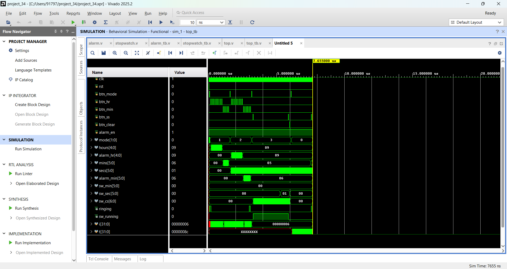
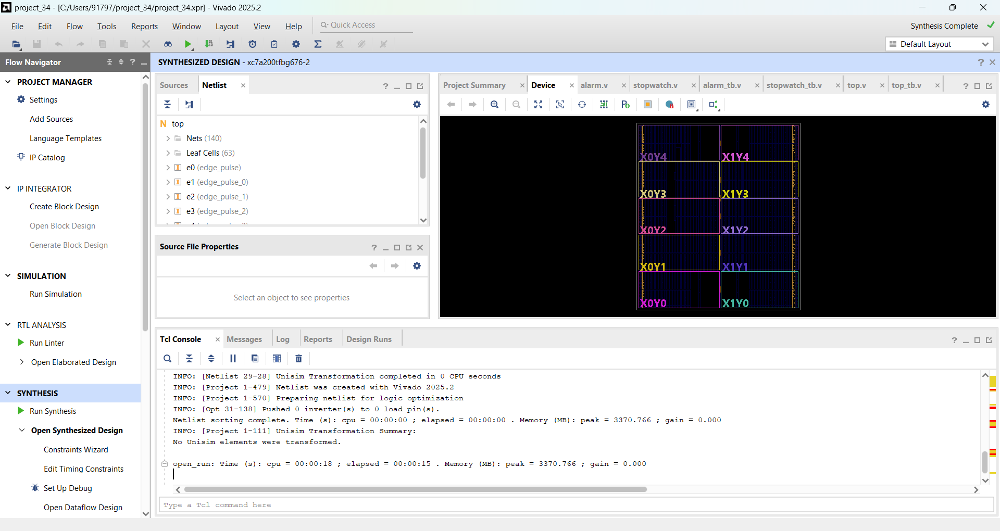
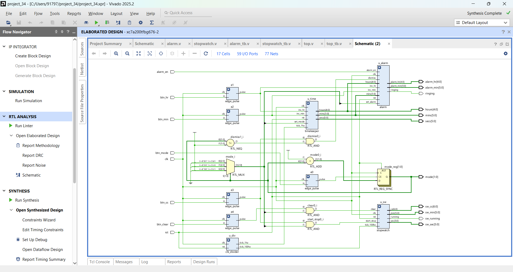
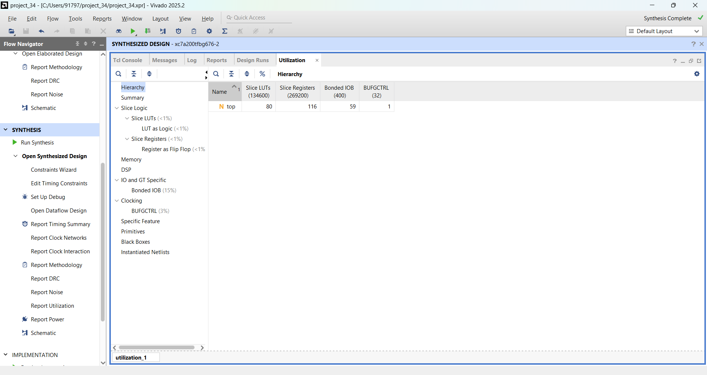

# Digital Alarm Clock and Stopwatch

A digital alarm clock and stopwatch written in Verilog, simulated and synthesized in Xilinx Vivado (Artix-7 xc7a200t).
It keeps 24-hour time, rings an alarm at a set time, and has a start/stop/clear stopwatch. A mode FSM selects what the buttons do.

## Modes

| Mode | Name | What the buttons do |
|---|---|---|
| 0 | CLOCK | Normal time-keeping. btn_ss dismisses a ringing alarm |
| 1 | SET_TIME | Clock stops. btn_hr / btn_min increase hours / minutes |
| 2 | SET_ALARM | btn_hr / btn_min set the alarm time |
| 3 | STOPWATCH | btn_ss start/stop, btn_clear clear (only when stopped) |

btn_mode moves to the next mode: CLOCK -> SET_TIME -> SET_ALARM -> STOPWATCH -> CLOCK.

## Files

| File | Description |
|---|---|
| clk_divider.v | Generates a 1 Hz tick (clock) and a 100 Hz tick (stopwatch) from 100 MHz |
| timekeeper.v | HH:MM:SS counter (24 h) with time setting and midnight rollover |
| alarm.v | Alarm time register, match logic, ringing, dismiss and enable |
| stopwatch.v | MM:SS.CS stopwatch with start/stop and clear |
| top.v | Mode FSM, button edge detection, connects all modules |

### Testbenches

| File | Tests |
|---|---|
| clk_tb.v (module clock_tb) | clk_divider + timekeeper: time set, seconds, midnight rollover |
| alarm_tb.v | Alarm set, ring, dismiss, enable/disable |
| stopwatch_tb.v | Start, stop, hold, resume, clear, minute rollover (checked against a reference counter) |
| top_tb.v | Full system: mode changes, time set, alarm set, stopwatch, alarm ringing and dismiss with buttons |

The testbenches use small divider values so the simulation runs fast (1 "second" = 10 clock cycles).

## Results

### Simulation waveform (top_tb)
Mode changes (SET_TIME, SET_ALARM, STOPWATCH, CLOCK), time set to 09:05, alarm set to 09:06, stopwatch start/stop/clear, and the alarm ringing at 09:06.

### Synthesis

### Schematic

### Utilization
80 LUTs and 116 flip-flops (less than 1% of the device).

## How to run

1. Create a Vivado RTL project and add all design files as design sources.
2. Add the testbenches as simulation sources.
3. Set a testbench (for example top_tb) as top, run Behavioral Simulation, then run all in the Tcl console.
4. For synthesis, set top as the top module and click Run Synthesis.

## Status

Simulation and synthesis are complete. Button debouncing, a 7-segment display driver and pin constraints for a physical board are not added yet.
